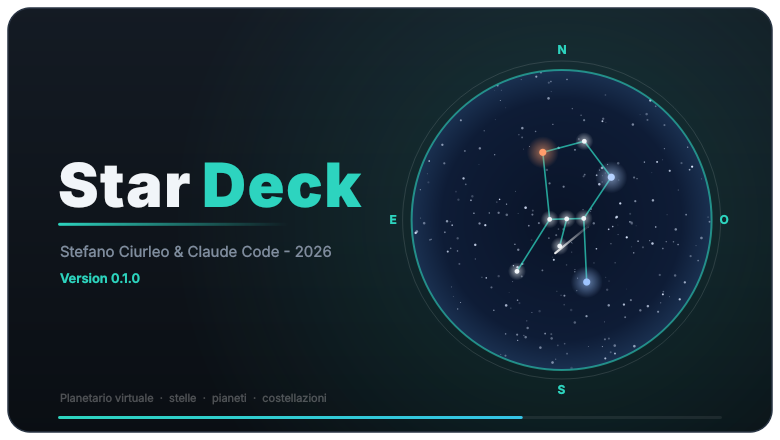
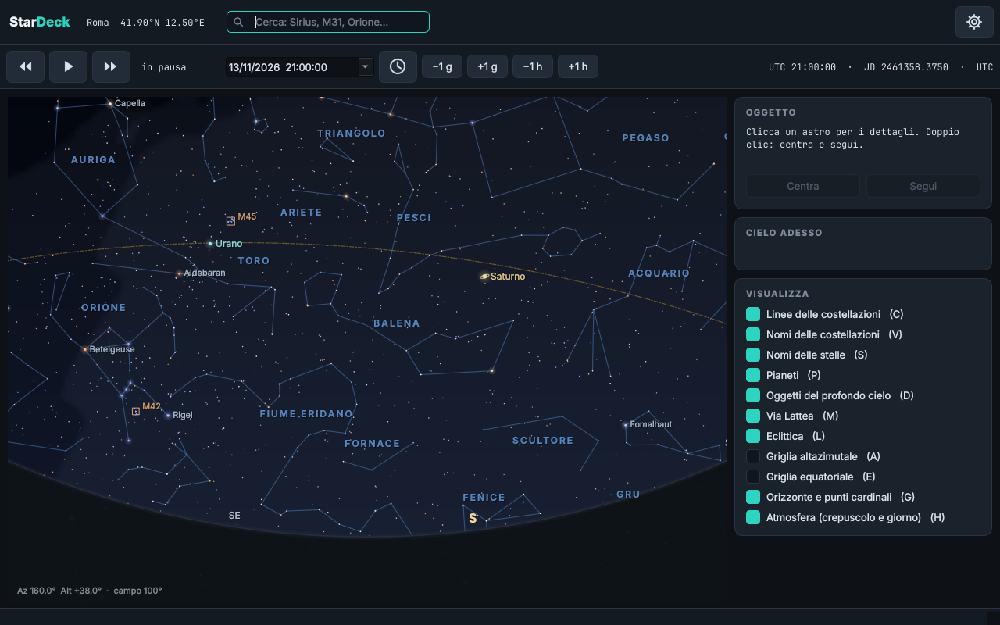
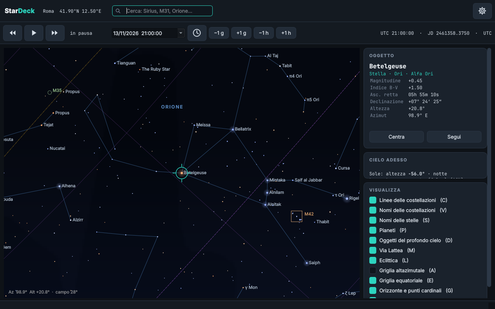

# StarDeck

<p align="center"></p>

Planetario virtuale: il cielo di **qualsiasi luogo e momento**, con stelle, costellazioni, Sole, Luna (con la fase) e pianeti.
Python 3 + Qt6 (PySide6), stessa interfaccia scura e stessa struttura di [NetDeck](https://github.com/stefanolmo/landeck), CNC Deck e SolarDeck.
Nessuna dipendenza oltre a PySide6: i calcoli astronomici sono scritti in Python puro (`stardeck/astro.py`), il catalogo è incluso nel pacchetto.

<p align="center"></p>

## Cosa c'è (versione 0.1)

- **Cielo**: proiezione stereografica a tutto cielo, ~5000 stelle fino a magnitudine 6 con colore dall'indice B−V, 88 costellazioni
  (figure e nomi in italiano), 108 oggetti Messier + i principali NGC/IC (ammassi, nebulose, galassie), Via Lattea.
- **Sistema solare**: Sole, Luna (fase e inclinazione corrette, parallasse topocentrica) e i sette pianeti da Mercurio a Nettuno, con magnitudine.
- **Tempo**: tempo reale, pausa, avanti/indietro ×60, ×3600, ×86400 (1 min, 1 h, 1 giorno al secondo), ±1 ora/giorno, data e ora editabili, «adesso».
- **Luogo**: 34 città/località predefinite o coordinate personalizzate (Impostazioni, `Ctrl+,`); fuso orario di sistema.
- **Atmosfera**: colore del cielo da giorno a notte secondo l'altezza del Sole, stelle e pianeti deboli che spariscono col chiaro, orizzonte con punti cardinali.
- **Interazione**: trascina per orientare, rotella per lo zoom (campo da 150° a 1°), clic su un astro per i dettagli (coordinate, altezza/azimut,
  magnitudine…), doppio clic per centrarlo e **seguirlo** mentre il cielo ruota, ricerca per nome (`Sirius`, `M31`, `Orione`, `Giove`…).
- **Livelli** (tutti attivabili da pannello o da tastiera): linee e nomi delle costellazioni `C`/`V`, nomi stelle `S`, pianeti `P`, profondo cielo `D`,
  Via Lattea `M`, eclittica `L`, griglia altazimutale `A` ed equatoriale `E`, orizzonte `G`, atmosfera `H`. Frecce e `+`/`−` per muoversi e zoomare;
  `Spazio` pausa, `J`/`K` rallenta/accelera, `N` adesso.

<p align="center"></p>

## Installazione (Ubuntu)

```bash
./install.sh            # venv in ~/.local/share/stardeck, comando "stardeck", voce di menu
stardeck                # il cielo di adesso, per il luogo salvato (default Roma)
stardeck --time "2026-12-24 22:30" --lat 38.9 --lon 16.6 --view 180,40,90      # data, luogo e vista a piacere
stardeck --no-splash    # senza splash screen di 3 secondi (o STARDECK_NO_SPLASH=1)
```

Senza installare: `pip install -r requirements.txt && python3 -m stardeck`.
Pacchetto .deb (usa PySide6 di sistema): `packaging/build-deb.sh`, poi `sudo apt install ./dist/stardeck_0.1.0_all.deb`.

## Come funziona

| Cosa | Metodo | Precisione |
|---|---|---|
| Stelle | catalogo J2000 (Yale/Hipparcos tramite d3-celestial) + precessione IAU 1976 | ~0,01° (senza moto proprio, aberrazione, rifrazione) |
| Sole e pianeti | elementi kepleriani JPL «approximate positions» 1800–2050 | pochi primi d'arco (Giove/Saturno fino a ~10′) |
| Luna | serie troncata di Meeus cap. 47 + parallasse | < 1′ (verificata sull'esempio 47.a di Meeus) |
| Tempo siderale | GMST (IAU) | < 1″ |
| Magnitudini pianeti | formule dell'Astronomical Almanac, senza anelli di Saturno | ±0,3 |

I calcoli sono verificati nei test contro valori noti (esempi di Meeus, congiunzione Venere–Giove del 9 giugno 2026, luna nuova/piena di novembre 2026)
e, durante lo sviluppo, contro astropy (Sirio: errore in altezza/azimut 0,006°).
Il catalogo (`stardeck/data/sky.json.gz`, 157 KiB) si rigenera con `python3 tools/build_catalog.py`; i dati vengono da
[d3-celestial](https://github.com/ofrohn/d3-celestial) di Olaf Frohn (licenza BSD-3).

## Limiti noti (da qui si parte per le prossime versioni)

- Catalogo fino a magnitudine 6: a campi molto stretti (< 10°) mancano le stelle più deboli; niente stelle doppie/variabili, niente moto proprio.
- Via Lattea come contorni di luminosità sfumati, non come immagine; nessuna texture della Luna né dei pianeti (Saturno ha un anello disegnato, fisso).
- Mancano: orari di alba/tramonto/culmine, satelliti (ISS), comete, asteroidi, eclissi, confini delle costellazioni, rifrazione atmosferica,
  luce lunare nel colore del cielo, modalità a schermo intero/proiezione, esportazione di immagini.
- Il fuso orario è quello del sistema, non quello del luogo scelto: per vedere il cielo di Tokyo «alle 22 locali» imposta l'ora in base al tuo fuso
  (o usa `--time ...Z` in UTC).
- Verificato nella sandbox di sviluppo (Linux, Qt offscreen, 26 test, screenshot): **non** ancora provato su un desktop Ubuntu reale con mouse e GPU;
  il rendering è software (QPainter), ~20 ms a pieno campo.

## Sviluppo

```bash
pip install -r requirements.txt pytest
QT_QPA_PLATFORM=offscreen python3 -m pytest          # astronomia, catalogo, proiezione, interazione, UI
QT_QPA_PLATFORM=offscreen python3 docs/make_screenshots.py
```

Struttura: `astro.py` (tempo, coordinate, Sole/Luna/pianeti), `catalog.py` (dati), `skyview.py` (disegno e interazione del cielo),
`mainwindow.py`, `settings_dialog.py`, `places.py`, `splash.py`, `theme.py`, `config.py`. Impostazioni in `~/.config/stardeck/stardeck.conf`.
